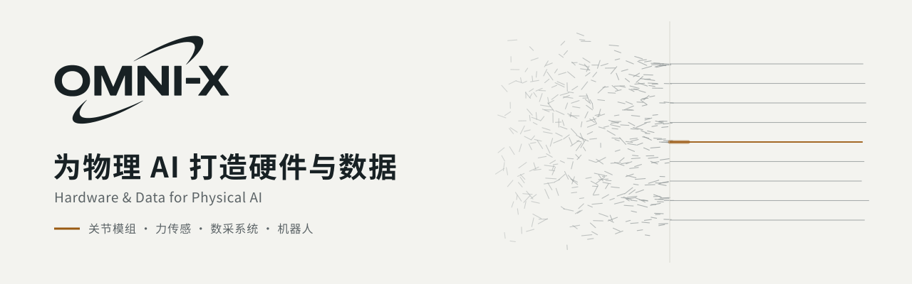
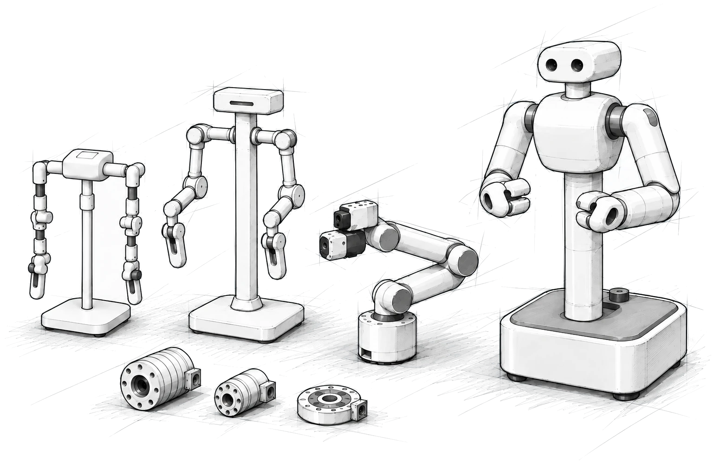
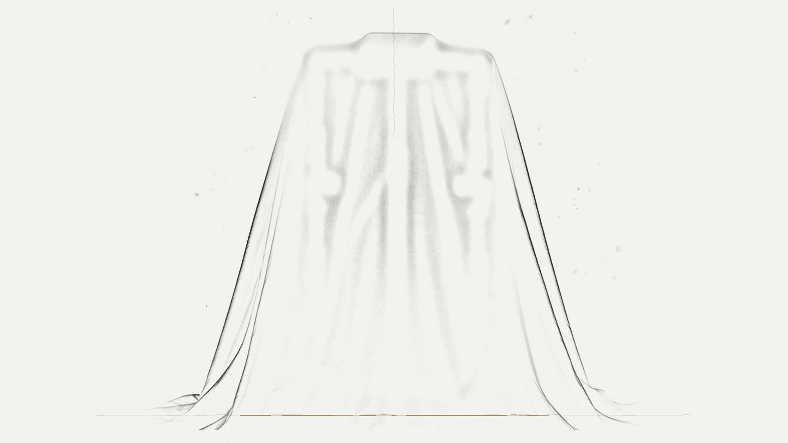

<picture>
  <source media="(prefers-color-scheme: dark)" srcset="assets/banner-dark.svg">
  
</picture>

 

### 物理 AI 时代的基础设施提供商

我们把**电机、力控与感知**做成机器人的器官，再用**人手的示范**为它积累数据：让 AI 用自己的身体感知真实世界，在使用中自我迭代。

*We build the joints, force sensing and data systems that let AI feel the physical world, then grow its skills from human demonstration.*

  

---

## 产品 · Products

<table>
<tr>
<td width="33%" valign="top">

<h3>OmniLink Pro</h3>
双向力反馈主控臂，用于遥操作与力觉数据采集。 
Force-feedback leader arm for teleoperation &amp; force-aware data collection.  
<a href="https://www.omnix-robot.com/omnilink/pro"><b>了解更多 →</b></a>
</td>
<td width="33%" valign="top">

<h3>OmniLink Lite <code>即将揭幕</code></h3>
轻量编码器主控臂，适配批量采集与产线示教。 
Lightweight encoder leader arm for fleet-scale collection &amp; line teaching.  
<a href="https://www.omnix-robot.com/omnilink/lite"><b>了解更多 →</b></a>
</td>
<td width="33%" valign="top">

<h3>OmniPipe <code>即将推出</code></h3>
采集即标注即质检，贯通数据到模型的闭环。 
Capture, annotate and QA in one pass, closing the loop from data to model.
</td>
</tr>
</table>

### OmniLink Pro：给具身智能团队一台采数据的趁手设备

| 特性 | 说明 |
|---|---|
| **双向力反馈** | 主从同构，机器人端受力实时回传到操作者手中；插拔、拧紧、抓易碎件凭手感完成，示范数据自带力觉标签。 |
| **低时延链路** | 本地往返 **< 20 ms**，公网往返 **< 50 ms**。 |
| **两种形态** | 桌面式适合固定工位精细作业；穿戴式适合大范围动作与移动采集。 |
| **全程重力补偿** | 主臂在任意位置松手即停、悬停无漂移，长时间示范也能保持数据一致。 |

---

## 关于我们 · About

**让机器的劳动有价，让人的劳动无价。**

我们的使命是打造世界级的自由企业，让人成为人，让机器人更像人。

| 法度即自由 | 技进乎道 | 只认真实 | 功归其人 |
|:---|:---|:---|:---|
| 规则少而清楚，对谁都一样；规则之外，交给自律。 | 把一件事反复做到极致，直到它成为乐趣本身。 | 成败看事实，价值看客户。每个人都可以对任何决定说“不对”。 | 按贡献论功，不按资历和关系；谁创造的，就归谁。 |

## 联系我们 · Contact

- 🤝 商务合作：[business@omnix-robot.com](mailto:business@omnix-robot.com)　·　[预约演示](https://www.omnix-robot.com/contact)
- 🛠️ 技术支持：[support@omnix-robot.com](mailto:support@omnix-robot.com)
- 🧑‍💻 加入我们：[www.omnix-robot.com/careers](https://www.omnix-robot.com/careers)
- 📍 广东省东莞市松山湖学府路 1 号 G4 栋

© 2026 全为具身科技有限公司 · OMNI-X Robotics

