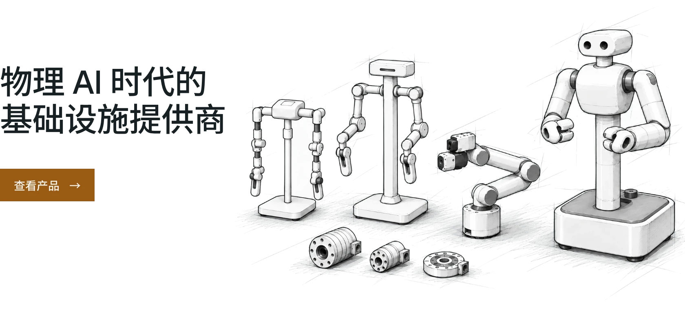
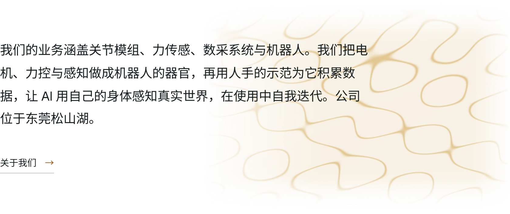
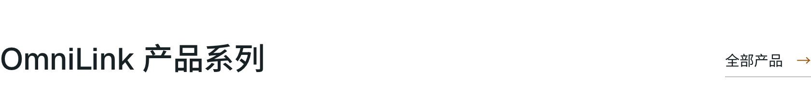
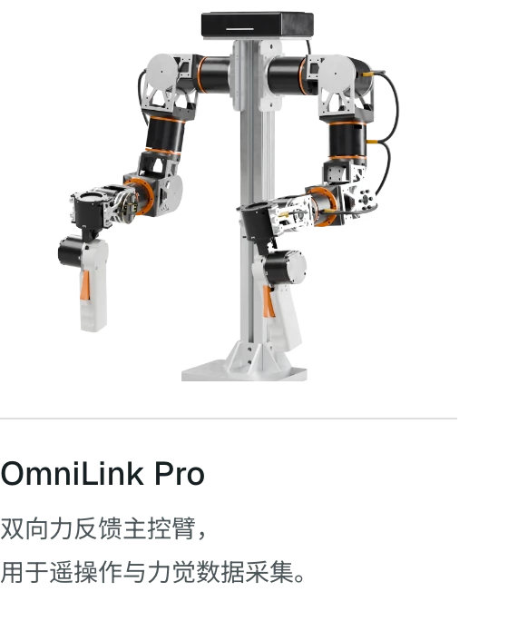
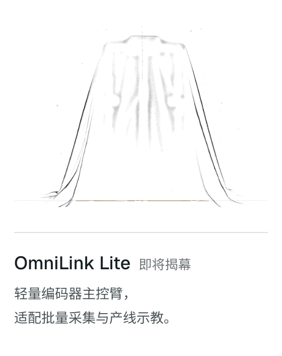
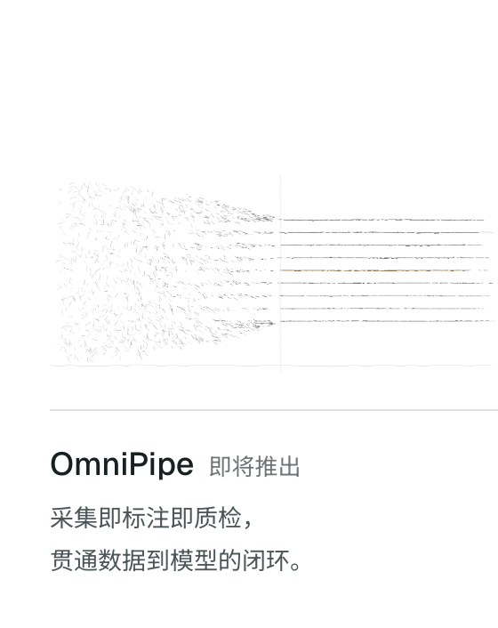
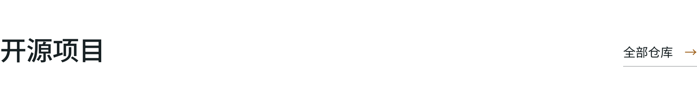
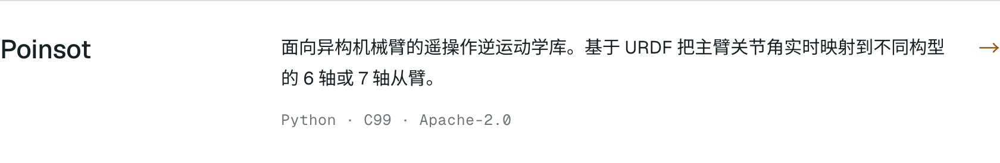
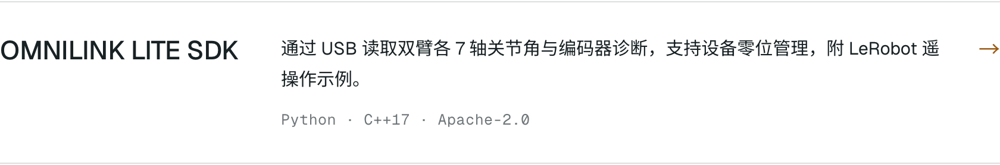
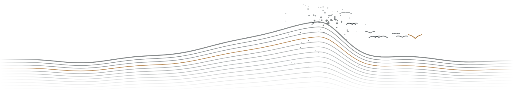

<a href="https://www.omnix-robot.com/"><picture><source media="(prefers-color-scheme: dark)" srcset="assets/nav-logo-dark.webp"></picture></a><a href="https://github.com/omnix-robot/omnix-robot/blob/main/README.en.md"><picture><source media="(prefers-color-scheme: dark)" srcset="assets/nav-lang-zh-dark.webp"></picture></a>

<a href="https://www.omnix-robot.com/products"><picture><source media="(prefers-color-scheme: dark)" srcset="assets/hero-zh-dark.webp"></picture></a>

<a href="https://www.omnix-robot.com/about"><picture><source media="(prefers-color-scheme: dark)" srcset="assets/statement-zh-dark.webp"></picture></a>

<a href="https://www.omnix-robot.com/omnilink"><picture><source media="(prefers-color-scheme: dark)" srcset="assets/head-products-zh-dark.webp"></picture></a>

<a href="https://www.omnix-robot.com/omnilink/pro"><picture><source media="(prefers-color-scheme: dark)" srcset="assets/card-pro-zh-dark.webp"></picture></a><a href="https://www.omnix-robot.com/omnilink/lite"><picture><source media="(prefers-color-scheme: dark)" srcset="assets/card-lite-zh-dark.webp"></picture></a><a href="https://www.omnix-robot.com/products"><picture><source media="(prefers-color-scheme: dark)" srcset="assets/card-pipe-zh-dark.webp"></picture></a>

<a href="https://github.com/omnix-robot?tab=repositories"><picture><source media="(prefers-color-scheme: dark)" srcset="assets/head-oss-zh-dark.webp"></picture></a>

<a href="https://github.com/omnix-robot/poinsot"><picture><source media="(prefers-color-scheme: dark)" srcset="assets/oss-poinsot-zh-dark.webp"></picture></a> <a href="https://github.com/omnix-robot/omnilink_lite_sdk"><picture><source media="(prefers-color-scheme: dark)" srcset="assets/oss-lite-sdk-zh-dark.webp"></picture></a>

<a href="https://www.omnix-robot.com/"><picture><source media="(prefers-color-scheme: dark)" srcset="assets/band-dark.webp"></picture></a>

<a href="https://www.omnix-robot.com/"><picture><source media="(prefers-color-scheme: dark)" srcset="assets/icon-site-dark.svg"></picture></a><a href="https://space.bilibili.com/1228002133"><picture><source media="(prefers-color-scheme: dark)" srcset="assets/icon-bilibili-dark.svg"></picture></a><a href="https://www.douyin.com/user/MS4wLjABAAAA3cGaMCp_anPmZbYBtItgxpqXoFfWbyUXEG76dVvuGQcqTYpkc3wDr0AlN9MQtLDu"><picture><source media="(prefers-color-scheme: dark)" srcset="assets/icon-tiktok-dark.svg"></picture></a><a href="https://www.xiaohongshu.com/user/profile/6a90f3b2000000001302200a"><picture><source media="(prefers-color-scheme: dark)" srcset="assets/icon-xiaohongshu-dark.svg"></picture></a><a href="https://www.linkedin.com/company/omnix-robot/"><picture><source media="(prefers-color-scheme: dark)" srcset="assets/icon-linkedin-dark.svg"></picture></a><a href="https://x.com/omnix_robot"><picture><source media="(prefers-color-scheme: dark)" srcset="assets/icon-x-dark.svg"></picture></a><a href="mailto:business@omnix-robot.com"><picture><source media="(prefers-color-scheme: dark)" srcset="assets/icon-mail-dark.svg"></picture></a>
