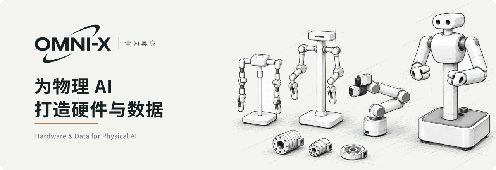
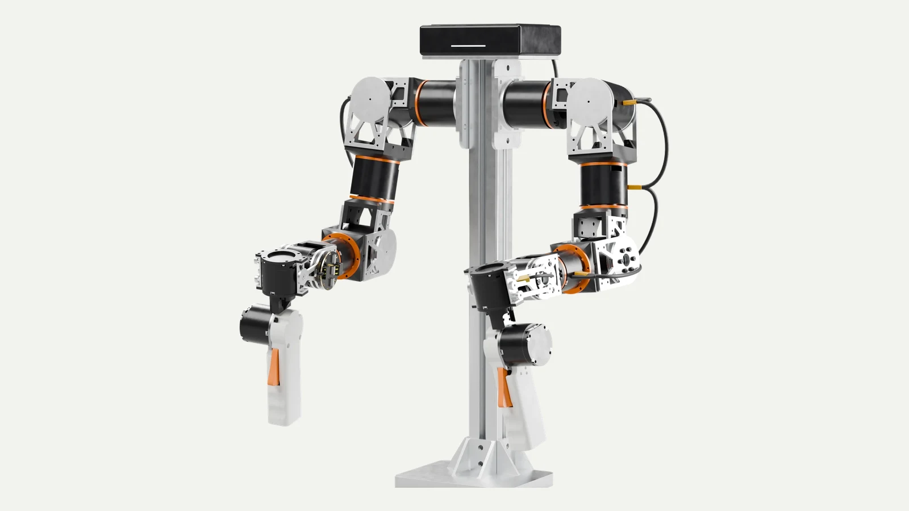

<a href="https://www.omnix-robot.com/"><picture><source media="(prefers-color-scheme: dark)" srcset="assets/icon-site-dark.svg"></picture></a><a href="https://space.bilibili.com/1228002133"><picture><source media="(prefers-color-scheme: dark)" srcset="assets/icon-bilibili-dark.svg"></picture></a><a href="https://www.douyin.com/user/MS4wLjABAAAA3cGaMCp_anPmZbYBtItgxpqXoFfWbyUXEG76dVvuGQcqTYpkc3wDr0AlN9MQtLDu"><picture><source media="(prefers-color-scheme: dark)" srcset="assets/icon-tiktok-dark.svg"></picture></a><a href="https://www.xiaohongshu.com/user/profile/6a90f3b2000000001302200a"><picture><source media="(prefers-color-scheme: dark)" srcset="assets/icon-xiaohongshu-dark.svg"></picture></a><a href="https://www.linkedin.com/company/omnix-robot/"><picture><source media="(prefers-color-scheme: dark)" srcset="assets/icon-linkedin-dark.svg"></picture></a><a href="https://x.com/omnix_robot"><picture><source media="(prefers-color-scheme: dark)" srcset="assets/icon-x-dark.svg"></picture></a><a href="mailto:business@omnix-robot.com"><picture><source media="(prefers-color-scheme: dark)" srcset="assets/icon-mail-dark.svg"></picture></a>

OMNI-X 全为具身，业务涵盖关节模组、力传感、机器人，以及遥操作与数据采集，致力于推动具身智能进入真实物理世界。

OMNI-X's business covers joint modules, force sensing, robots, and teleoperation and data-collection systems, advancing embodied intelligence in the physical world.

<table>
<tr>
<td width="33%" valign="top">
 
<b><a href="https://www.omnix-robot.com/omnilink/pro">OmniLink Pro</a></b> 
双向力反馈主控臂，用于遥操作与力觉数据采集。
</td>
<td width="33%" valign="top">
 
<b><a href="https://www.omnix-robot.com/omnilink/lite">OmniLink Lite</a></b> <code>即将揭幕</code> 
轻量编码器主控臂，适配批量采集与产线示教。
</td>
<td width="33%" valign="top">
 
<b>OmniPipe</b> <code>即将推出</code> 
采集即标注即质检，贯通数据到模型的闭环。
</td>
</tr>
</table>

## 开源项目 · Open source

<table>
<tr>
<td width="120" align="center" valign="middle">

</td>
<td valign="middle">
<b>Poinsot</b> 
面向异构机械臂的遥操作逆运动学库。基于 URDF 将主臂关节角实时映射到不同构型的 6 轴或 7 轴从臂。 
Inverse kinematics for cross-robot teleoperation. Maps master joint angles to 6- or 7-axis follower arms in real time using URDF models. 
Python · C99 · Apache 2.0 
<a href="https://github.com/omnix-robot/poinsot">GitHub</a> · <a href="https://github.com/omnix-robot/poinsot#readme">中文文档</a> · <a href="https://github.com/omnix-robot/poinsot/blob/main/README.en.md">English docs</a>
</td>
</tr>
</table>

商务合作 [business@omnix-robot.com](mailto:business@omnix-robot.com) · 技术支持 [support@omnix-robot.com](mailto:support@omnix-robot.com)
