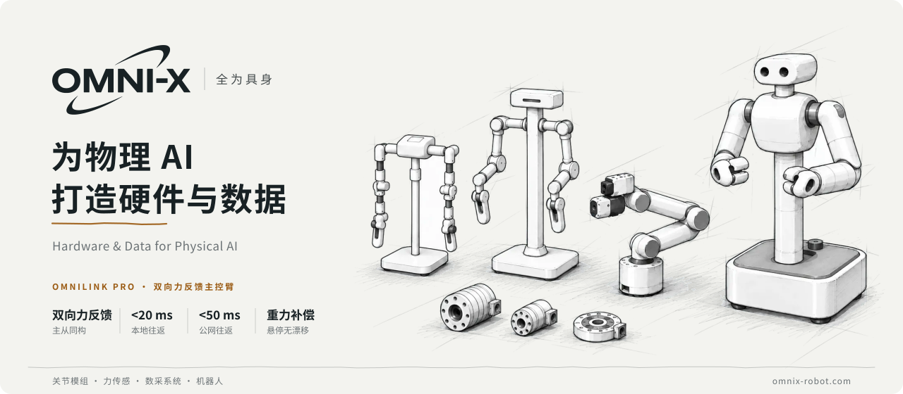
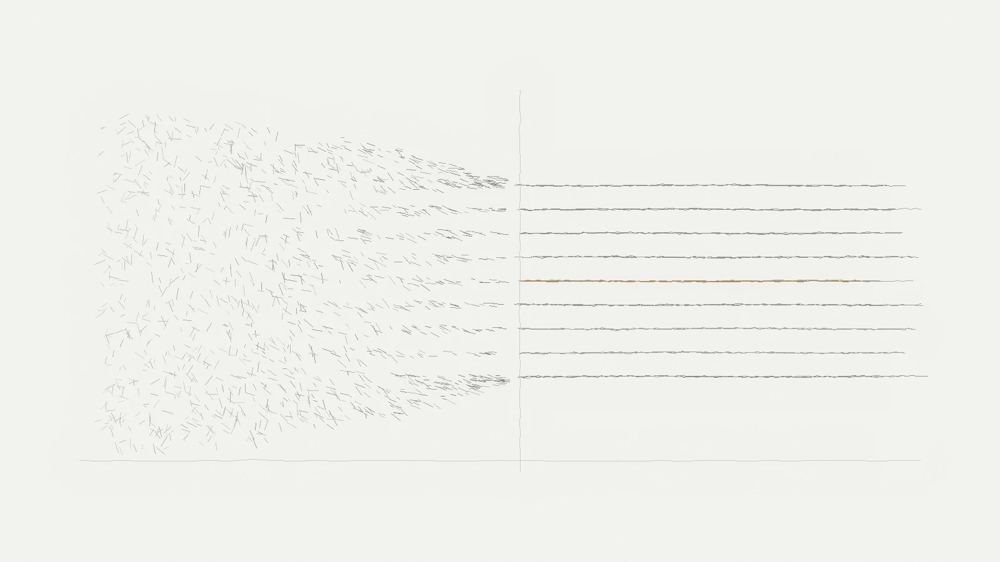

<a href="https://www.omnix-robot.com/"><picture><source media="(prefers-color-scheme: dark)" srcset="assets/icon-site-dark.svg"></picture></a><a href="https://space.bilibili.com/1228002133"><picture><source media="(prefers-color-scheme: dark)" srcset="assets/icon-bilibili-dark.svg"></picture></a><a href="https://www.douyin.com/user/MS4wLjABAAAA3cGaMCp_anPmZbYBtItgxpqXoFfWbyUXEG76dVvuGQcqTYpkc3wDr0AlN9MQtLDu"><picture><source media="(prefers-color-scheme: dark)" srcset="assets/icon-tiktok-dark.svg"></picture></a><a href="https://www.xiaohongshu.com/user/profile/6a90f3b2000000001302200a"><picture><source media="(prefers-color-scheme: dark)" srcset="assets/icon-xiaohongshu-dark.svg"></picture></a><a href="https://www.linkedin.com/company/omnix-robot/"><picture><source media="(prefers-color-scheme: dark)" srcset="assets/icon-linkedin-dark.svg"></picture></a><a href="https://x.com/omnix_robot"><picture><source media="(prefers-color-scheme: dark)" srcset="assets/icon-x-dark.svg"></picture></a><a href="mailto:business@omnix-robot.com"><picture><source media="(prefers-color-scheme: dark)" srcset="assets/icon-mail-dark.svg"></picture></a>

OMNI-X 全为具身为具身智能团队做数据采集与遥操作硬件：关节模组、力传感、主控臂和数据系统。让机器人从人手的示范里学会做事。

OMNI-X builds teleoperation and data-collection hardware for embodied AI: joint modules, force sensing, leader arms and the data pipeline behind them.

<table>
<tr>
<td width="33%" valign="top">
 
<b><a href="https://www.omnix-robot.com/omnilink/pro">OmniLink Pro</a></b> 
双向力反馈主控臂，用于遥操作与力觉数据采集。
</td>
<td width="33%" valign="top">
 
<b><a href="https://www.omnix-robot.com/omnilink/lite">OmniLink Lite</a></b> <code>即将揭幕</code> 
轻量编码器主控臂，适配批量采集与产线示教。
</td>
<td width="33%" valign="top">
 
<b>OmniPipe</b> <code>即将推出</code> 
采集即标注即质检，贯通数据到模型的闭环。
</td>
</tr>
</table>

商务合作 [business@omnix-robot.com](mailto:business@omnix-robot.com) · 技术支持 [support@omnix-robot.com](mailto:support@omnix-robot.com) · [预约演示](https://www.omnix-robot.com/contact) · [加入我们](https://www.omnix-robot.com/careers)
